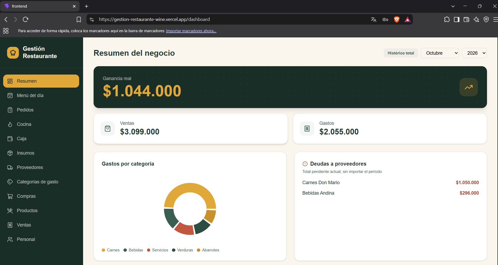

# Gestión de Restaurante

> Un restaurante no se quiebra por falta de clientes, sino por no saber en qué se le va la plata.

Sistema web full stack para operar un restaurante de principio a fin: pedidos del mesero, pantalla de cocina, caja con descuento automático de inventario, menú del día, compras, gastos y deudas con proveedores. Cada restaurante trabaja aislado de los demás y cada empleado entra con su propio rol.

**Demo:** https://gestion-restaurante-wine.vercel.app

| Campo | Valor |
| --- | --- |
| Correo | `demo2@restaurante-demo.com` |
| Clave | `ES_DEMOES` |

La cuenta de demostración tiene datos inventados. También puedes registrarte con cualquier correo y empezar con una cuenta vacía.

## Capturas

<!-- TODO: cambia los nombres por los de los archivos de tu carpeta docs/ -->



## El flujo de un servicio

1. **Mesero:** crea el pedido desde el celular con mesa, productos y notas. En los ejecutivos escoge la sopa y el principio.
2. **Cocina:** ve el pedido en una pantalla de solo lectura, con el color según el tiempo de espera y aviso de pedido nuevo.
3. **Mesero:** marca "Entregado" cuando lleva el plato a la mesa.
4. **Caja:** cobra. Se registra la venta y se descuenta el inventario según la receta de cada plato.

## Funcionalidades

- **Pedidos casi en tiempo real:** mesero, cocina y caja se actualizan cada 3 o 4 segundos.
- **Roles y permisos:** administrador, mesero, cocina y caja. Cada uno ve solo lo que necesita; el mesero solo ve y modifica sus propios pedidos.
- **Menú del día:** el administrador activa lo que hay hoy y el mesero solo ve eso.
- **Ejecutivos con sopa y principio:** sopas y principios son tipos de producto. El mesero escoge entre los activos del día, y si el cliente no lleva sopa se aplica un descuento configurable.
- **Panel principal** con el resumen del negocio.
- **Inventario** de insumos con alertas de stock bajo.
- **Productos y recetas:** cada plato descuenta sus insumos al venderse. Las bebidas pueden ligarse a un insumo de forma opcional.
- **Ventas** con descuentos y consumo interno.
- **Compras** que suman al inventario.
- **Proveedores y categorías de gasto.**
- **Personal:** el administrador crea y desactiva las cuentas de sus empleados.

## Decisiones técnicas

- **Permisos en el servidor, no en la interfaz.** El middleware de autenticación aplica una lista de rutas permitidas por rol, con denegación por defecto. Ocultar un botón en React es comodidad, no seguridad.
- **Aislamiento entre restaurantes.** Cada consulta filtra por el `user_id` del dueño. Los empleados llevan en su token el id del dueño, así que las consultas existentes funcionan sin cambios.
- **Cobro sin duplicados.** Confirmar un pedido bloquea la fila (`SELECT ... FOR UPDATE`) dentro de una transacción. Si dos cajeros confirman a la vez, el segundo recibe un 409 en lugar de cobrar dos veces.
- **Una sola lógica de venta.** `registrarVenta` es un servicio compartido: la venta directa y el cobro de un pedido descuentan inventario con el mismo código.
- **Transacciones SQL** en compras y ventas, para que el inventario nunca quede a medias.
- **Fechas como texto `AAAA-MM-DD`**, para evitar los corrimientos por zona horaria (UTC).
- **Protección de historial:** no se puede borrar un insumo que tiene movimientos asociados.
- **Seguridad de sesión:** JWT, contraseñas con bcrypt y límite de intentos de login (máximo 20 por IP cada 15 minutos).
- **Migraciones versionadas** en SQL, numeradas y seguras de repetir.

## Stack

| Capa | Tecnología |
| --- | --- |
| Frontend | React, Vite, Tailwind CSS v4, Framer Motion, Lucide |
| Backend | Node.js, Express |
| Base de datos | PostgreSQL |
| Seguridad | JWT, bcrypt, límite de intentos de login |
| Despliegue | Vercel (frontend), Railway (backend y base de datos) |

## Estructura

```
Gestion-Restaurante/
├── backend/
│   ├── controllers/     # lógica de cada módulo
│   ├── routes/
│   ├── middleware/      # autenticación y permisos por rol
│   ├── services/        # lógica compartida (ventas e inventario)
│   └── db/
│       ├── schema.sql   # esquema base
│       └── migrations/  # cambios posteriores, numerados
├── frontend/
│   └── src/
│       ├── pages/       # Pedidos, Cocina, Caja, Menú del día, Productos...
│       ├── components/
│       ├── context/     # sesión
│       └── services/    # llamadas a la API
├── scripts/
│   └── seedDemo.js      # datos de demostración
└── docs/                # capturas de pantalla
```

## Cómo correrlo en local

Requisitos: Node.js 18+ y PostgreSQL.

**1. Clonar**

```bash
git clone https://github.com/ING-AHC/Gestion-Restaurante.git
cd Gestion-Restaurante
```

**2. Base de datos**

```bash
createdb gestion_restaurante
psql -d gestion_restaurante -f backend/db/schema.sql
```

Luego aplica las migraciones en orden.

En Linux o macOS:

```bash
for f in backend/db/migrations/*.sql; do psql -d gestion_restaurante -f "$f"; done
```

En Windows (PowerShell):

```powershell
Get-ChildItem backend\db\migrations\*.sql | Sort-Object Name | ForEach-Object { psql -d gestion_restaurante -f $_.FullName }
```

**3. Backend**

```bash
cd backend
npm install
```

Crea `backend/.env`:

```
PORT=4000
DB_USER=postgres
DB_PASSWORD=tu_clave
DB_HOST=localhost
DB_PORT=5432
DB_NAME=gestion_restaurante
JWT_SECRET=una_clave_larga_y_aleatoria
```

```bash
npm run dev
```

**4. Frontend** (en otra terminal)

```bash
cd frontend
npm install
```

Crea `frontend/.env`:

```
VITE_API_URL=http://localhost:4000/api
```

```bash
npm run dev
```

Abre http://localhost:5173.

**5. Datos de demostración (opcional)**

Con el backend corriendo, carga una cuenta con datos inventados:

```bash
API_URL=http://localhost:4000/api DEMO_PASSWORD=ES_DEMOES node scripts/seedDemo.js
```

## Próximos pasos

- Aviso de "sin conexión" y cola de pedidos cuando se cae el internet.
- Cierre de caja diario e impresión de comprobante.
- Costo y margen por plato.
- Pruebas automáticas e integración continua.
- Recuperación de contraseña y copias de seguridad automáticas.

## Autor

**Alejandro Hurtado** · Ingeniero de Sistemas
[GitHub](https://github.com/ING-AHC) · [LinkedIn](www.linkedin.com/in/alejandro-hurtado-collazos-523843173

)